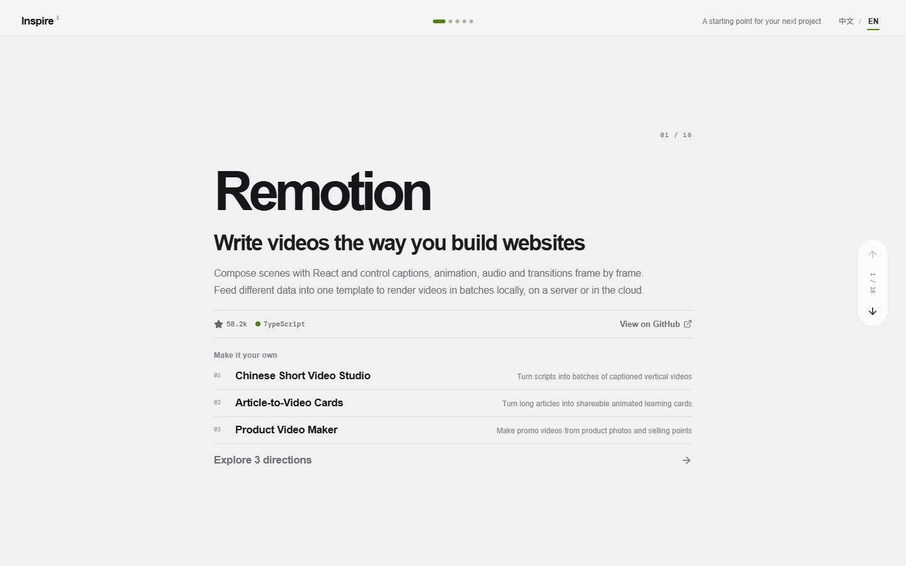

# GitHub Inspiration Feed

> An AI-assisted discovery and product-ideation platform that turns noteworthy open-source repositories into clear, actionable product opportunities.

[](https://react.dev/)
[](https://vite.dev/)
[](https://www.python.org/)
[](https://github.com/features/actions)

GitHub Inspiration Feed is built for Vibe Coding users who want more than a list of trending repositories. It gathers first-party evidence from GitHub, uses AI to explain what each project does, and proposes three concrete directions for building something new on top of it.

Every candidate goes through deterministic validation, editorial quality checks, and human review before it reaches the public feed. The result is a mobile-first browsing experience that connects open-source discovery with practical product thinking.



## Highlights

### Mobile-first inspiration feed

- Browse repositories one screen at a time with touch, mouse wheel, keyboard, and desktop pager navigation.
- See the repository's value proposition, stars, primary language, and original GitHub link at a glance.
- Explore three distinct redesign or extension ideas for every project.
- Open a detailed analysis covering capabilities, audience, technical foundation, opportunities, and a minimum viable scope.
- Switch the complete interface and all published editorial content between Chinese and English.

### Scalable frontend data loading

- Uses a lightweight project index for initial navigation.
- Stores each project's full content in an independent JSON file.
- Renders and caches only the active project and its nearby neighbors.
- Keeps the application deployable as a static site without a database or application server.

### AI-assisted repository discovery

- Searches across AI, automation, design, media, knowledge, productivity, data, education, self-hosting, and creator-tool categories.
- Filters repositories by activity, stars, README quality, license, and configurable exclusion rules.
- Separates verified GitHub facts from AI-generated semantic analysis.
- Generates an accessible project explanation, target audience, core capabilities, and three differentiated product directions.
- Applies 19 quality checks covering factual integrity, editorial clarity, direction diversity, and execution feasibility.
- Repairs only failed fields and preserves evidence when a candidate cannot be safely published.

The discovery workflow is currently started manually from GitHub Actions. It creates a review pull request for qualified candidates; merging that PR is the explicit approval to publish the batch.

### Safe maintenance of published projects

- Refreshes safe repository facts such as stars, forks, and last-pushed timestamps.
- Produces review evidence when README content, topics, releases, or repository status change.
- Never silently overwrites curated editorial copy, product directions, or visual identity.
- Escalates repository transfers, archival, visibility changes, and license changes for human review.

### Deterministic visual identity

- Uses each repository's full name as a stable seed.
- Generates a persistent accent color, foreground color, SVG motif, and motif variant.
- Checks hue and perceptual distance between adjacent projects to avoid repetitive visual sequences.
- Stores generated identity data with the project, so future algorithm changes do not unexpectedly redesign published entries.

### Version safety and recovery

- Creates snapshots and transaction records before automated publication or refresh operations.
- Supports inspecting version differences and restoring all projects or a selected project.
- Recovers the complete batch when a write fails, preventing partially updated production data.

## Product workflow

```text
Start discovery from GitHub Actions
                ↓
Search and filter GitHub repositories
                ↓
Save first-party repository evidence
                ↓
Generate editorial content and product directions with AI
                ↓
Run 19 quality checks and targeted repair
                ↓
Create a candidate review pull request
                ↓
Human merge confirms approval
                ↓
Publish canonical data and run the full test suite
                ↓
Display the project in the inspiration feed
```

The browser never calls the GitHub API or AI provider directly. API credentials stay in GitHub Actions or the local automation environment.

## Tech stack

| Area | Technology |
| --- | --- |
| Frontend | React, TypeScript, Vite, CSS, Lucide React |
| Automation | Python 3.12, Node.js 22, GitHub Actions |
| Repository data | GitHub REST API |
| AI analysis | OpenAI-compatible Chat Completions API |
| Storage | Canonical local JSON and generated split JSON |
| Internationalization | Typed UI messages and structurally validated English editorial data |
| Visual system | Deterministic color generation and inline SVG motifs |
| Safety | Git, snapshots, transaction logs, validation, and rollback |
| Quality | ESLint, TypeScript checks, Python and Node.js test suites |

## Architecture

The project deliberately separates facts, editorial content, visual identity, and presentation:

```text
GitHub REST API ──→ repository evidence ──→ deterministic facts
                                            │
                                            ├──→ AI editorial generation
                                            │       │
                                            │       └──→ quality checks and repair
                                            │
                                            └──→ human-reviewed publication
                                                        │
                                                        ↓
src/data canonical JSON ──→ build-time generator ──→ split runtime JSON
                                                        │
                                                        ↓
                                                React inspiration feed
```

Canonical project data lives in four layers under `src/data/`:

- `order.json` — feed order.
- `repositories.json` — verified GitHub facts and changing repository metrics.
- `editorial.json` — curated Chinese explanations and product directions.
- `visuals.json` — stable project colors and SVG identity parameters.

English editorial content lives in `src/locales/projects.en.json`. The generator requires every published project to have a structurally matching English entry; development and production builds fail if coverage is incomplete or Chinese copy leaks into English mode.

During development and production builds, `scripts/generate-project-data.mjs` generates:

- `public/data/projects/index.json` — lightweight navigation and first-screen data.
- `public/data/projects/<project-id>.json` — the complete record for one project.

Files under `public/data/projects/` are generated artifacts and should not be edited manually.

## Getting started

### Requirements

- Node.js 22
- npm
- Git
- Python 3.12 for discovery, refresh, validation, and publication tooling

### Install and run

```bash
git clone https://github.com/terry20230405-code/github-inspiration-feed.git
cd github-inspiration-feed
npm install
npm run dev
```

Open `http://127.0.0.1:5173`.

The `predev` script generates the lightweight index and split project files before Vite starts.

### Production build

```bash
npm run build
npm run preview
```

The static production output is written to `dist/`.

## GitHub automation setup

### 1. Add the AI API key

Open:

```text
Settings → Secrets and variables → Actions → New repository secret
```

Add:

```text
OPENAI_API_KEY=your-api-key
```

The variable name is retained for compatibility. Any provider implementing the configured OpenAI Chat Completions protocol can be used.

### 2. Configure optional variables

- `AI_API_BASE_URL` — override the configured API base URL.
- `AI_MODEL` — override the configured model.
- `AI_STREAM` — override streaming behavior when supported.

### 3. Configure Actions permissions

Allow GitHub Actions to:

- Write repository contents.
- Create pull requests.

GitHub supplies `GITHUB_TOKEN` automatically. Never commit API keys or access tokens to the repository or frontend bundle.

### 4. Run discovery

Open the repository's **Actions** tab, select **自动发现 GitHub 灵感项目**, and choose **Run workflow**.

The workflow creates a candidate review PR:

- **Merge** — approve the full batch for publication.
- **Close** — reject the batch without changing the production feed.
- **Failed checks** — stop publication and preserve audit artifacts for investigation.

Search categories, star thresholds, activity windows, and candidate limits are configured in `config/discovery.json`.

## Common commands

| Command | Purpose |
| --- | --- |
| `npm run dev` | Generate runtime data and start the development server |
| `npm run build` | Generate data, type-check, and build for production |
| `npm run preview` | Preview the production build |
| `npm run lint` | Run frontend lint checks |
| `npm run test:i18n` | Validate complete Chinese and English coverage |
| `npm run test:feed-data` | Validate generated runtime project files |
| `npm run test:feed-window` | Test the windowed feed-loading strategy |
| `npm run test:visual-identity` | Test color generation and adjacent-color avoidance |
| `npm run test:identity-renderer` | Test generic SVG motif rendering |
| `npm run discover:repositories` | Preview repository discovery locally |
| `npm run refresh:cycle` | Preview the published-project refresh cycle |
| `npm run refresh:cycle:write` | Apply safe repository fact updates |
| `npm run versions:list` | List recoverable data snapshots |
| `npm run versions:diff -- <snapshot-id>` | Compare a snapshot with current data |
| `npm run versions:restore -- <snapshot-id> --write` | Restore a snapshot |

## Project structure

```text
.github/workflows/                  Discovery and publication workflows
config/discovery.json               Discovery categories and limits
scripts/                            Frontend data generation and Node.js tests
skills/github-inspiration-editor/   Research, generation, validation, and refresh system
src/                                React application
src/data/                           Canonical published project data
src/locales/                        English editorial translations and localization rules
outputs/                            Audits, candidate batches, refresh records, and snapshots
```

## Further documentation

- [Content contract](skills/github-inspiration-editor/references/content-contract.md)
- [Discovery workflow](skills/github-inspiration-editor/references/discovery-workflow.md)
- [Published-project maintenance](skills/github-inspiration-editor/references/automation-workflow.md)
- [Editorial quality rubric](skills/github-inspiration-editor/references/quality-rubric.md)
- [Targeted repair loop](skills/github-inspiration-editor/references/quality-repair-loop.md)
- [Deterministic visual identity](skills/github-inspiration-editor/references/visual-identity.md)
- [Version control and recovery](skills/github-inspiration-editor/references/version-control-workflow.md)
- [Localization guide](skills/github-inspiration-editor/references/localization-guide.md)
